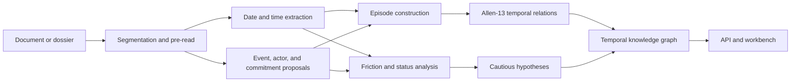
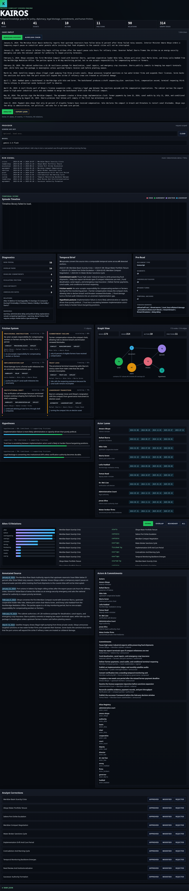

# KAIROS

**Rust-first temporal analysis for policy, legal, diplomatic, and institutional text.**

[](Cargo.toml)
[](LICENSE)


KAIROS turns long-form text into a source-grounded temporal knowledge graph: dated events, actors, commitments, episodes, friction signals, hypotheses, and Allen-13 temporal relations.

> **Experimental research software.** KAIROS is not a production decision system, legal-analysis service, or substitute for expert judgment. Breaking changes are expected, and any deployment or model-backed result should be verified against the current commit.

## 30-second read

- **Problem:** conventional summaries flatten sequence, duration, overlap, delay, and the changing status of commitments.
- **Approach:** deterministic Rust components own text spans, date normalization, graph assembly, diagnostics, and temporal relations; an optional model layer proposes structured objects behind typed contracts.
- **Output:** an inspectable graph linking evidence spans to actors, events, commitments, episodes, frictions, and cautious hypotheses.
- **Current scope:** local library, API, and demonstration interface. Production hardening and comparative evaluation remain future work.

## What KAIROS produces

An `AnalysisResult` can contain:

| Field | Purpose |
| --- | --- |
| `pre_read` | Document structure, segments, speaker turns, chronology blocks, and tension markers |
| `dates` | Temporal mentions, resolution, fuzziness, kind, and source spans |
| `events` | Canonical events with timestamps and evidence |
| `actors` / `actor_registry` | Canonical actors and deterministic aliases |
| `commitments` | Who committed to what, to whom, and with what status |
| `frictions` | Conflict, cooperation, and ambiguity signals with evidence grades |
| `hypotheses` | Explicitly marked inferences tied to supporting objects |
| `episodes` | Coherent temporal intervals with boundaries and confidence |
| `relations` | Allen-13 relations between episodes |
| `source_index` | Object-to-span and object-to-segment lookups |
| `graph` | Typed nodes and edges for downstream use |
| `diagnostics` | Warnings, unresolved dates, counts, and confidence summaries |

## Why temporal structure matters

Policy and institutional dossiers rarely describe a clean sequence. Sanctions may overlap negotiations; a court ruling may interrupt enforcement without ending it; leadership may change while institutional commitments persist; implementation windows may be missed, extended, or quietly superseded. KAIROS represents these states explicitly rather than compressing them into a single narrative paragraph.

## Architecture



Core design choices:

- source spans and diagnostics remain first-class objects;
- deterministic code owns normalization, relation logic, and graph assembly;
- model providers are optional implementation paths, not the product boundary;
- hypotheses remain distinguishable from extracted or directly observed facts;
- stable string identifiers support export and later integration without requiring a graph database.

## Local quick start

Requirements: Rust 1.95.0 or newer. Mock mode does not require an external model key.

```bash
git clone https://github.com/sargonxg/KAIROS-temporal-vision-TACITUS.git
cd KAIROS-temporal-vision-TACITUS
cargo test
KAIROS_LLM=mock cargo run --release --bin kairos-server
```

The server binds to `127.0.0.1:8080` by default. Set `KAIROS_BIND_ADDRESS` to an explicit IP when another interface is needed; the Docker image sets `0.0.0.0` for container ingress. `PORT` must be 1–65535. Binding outside loopback does not add authentication; retain the documented deployment controls.

Optional Gemini-backed extraction:

```bash
GEMINI_API_KEY="..." KAIROS_LLM=gemini cargo run --release --bin kairos-server
```

Use server-side credentials and review the data path before submitting sensitive material. Do not treat a public demonstration deployment as a confidential processing environment.

## API example

```bash
curl -X POST http://localhost:8080/api/v1/analyze \
  -H 'Content-Type: application/json' \
  -d '{
    "text": "January 15, 2024: Riverdale announces rationing. March 12: leadership changes.",
    "document_id": "case-001",
    "document_created_at": "2024-03-12T00:00:00Z",
    "analysis_mode": "auto"
  }'
```

Additional endpoints expose graph output and validation. The API contract, not any particular hosted instance, is the intended integration surface.

## Inspect the temporal workbench



This screenshot comes from the locally running server with `KAIROS_LLM=mock`. The scenario is synthetic. It demonstrates the interface and temporal representation, not live extraction accuracy or a real political assessment.

## Place in the TACITUS stack

- [AGON](https://github.com/sargonxg/AGON) explores evidence-linked conflict perception: claims, commitments, contradictions, and friction patterns.
- **KAIROS** provides temporal structure: when events occurred, how episodes overlap, and which commitments remain active, contested, or superseded.
- [DIALECTICA](https://github.com/sargonxg/A3_DIALECTICAbyTACITUS_v3) builds reviewable, portable context capsules for PRAXIS.

The systems are independently inspectable. Integration remains contract-driven and should not be inferred from naming alone.

## Evaluation and limitations

KAIROS includes deterministic fixtures and testable contracts, but the repository does not claim validated superiority over general-purpose models or established temporal-information systems. Claims about recall, precision, analyst usefulness, or downstream decision quality require controlled evaluation on published data. Model-generated objects may be incomplete or wrong; dates may be ambiguous; and an internally coherent graph can still encode a mistaken interpretation.

See [SPEC.md](SPEC.md), [ROADMAP.md](ROADMAP.md), [BUILD.md](BUILD.md), [SECURITY.md](SECURITY.md), and [CONTRIBUTING.md](CONTRIBUTING.md) for the detailed contract, planned work, build notes, security posture, and contribution guidance.

## License

Apache License 2.0. See [LICENSE](LICENSE).
